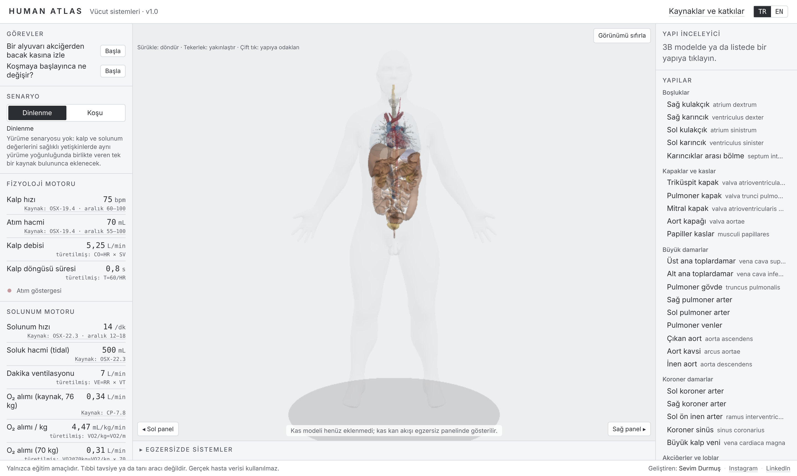
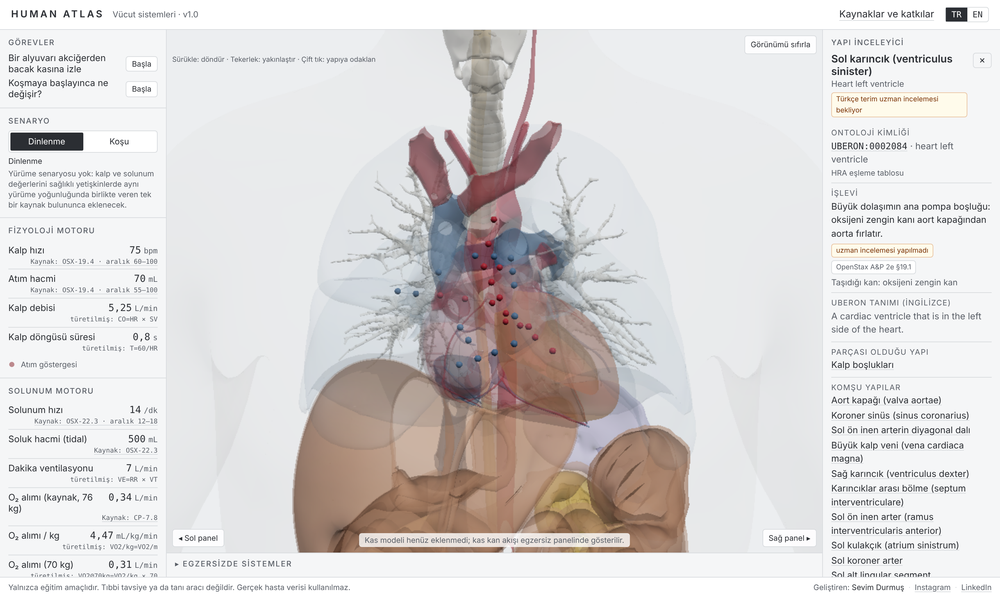
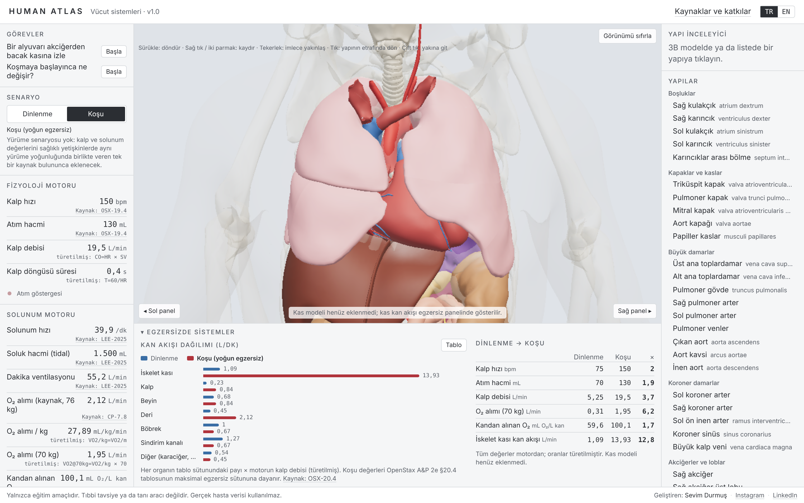

# HUMAN ATLAS

**An interactive 3D atlas of the human body that runs in the browser: anatomy (structure) and physiology (function), with every model, number and term traced to a source.**

**▶ Live: https://sevimsoffice.github.io/human-atlas/** · Release **v1.0** · Turkish (default) and English

> Educational only. Not medical advice, not a diagnostic tool, no patient data.







## What it does
- **Whole body, then the organs inside it.** The atlas opens on a full male body: opaque organs in clearly different colours, the labelled HuBMAP pelvis and leg bones, a pale full skeleton (NIH 3D CT) and a very faint skin outline (10 % opacity, drawn last so it never hides anything). It then zooms in on the heart and lungs. *Görünümü sıfırla / Reset view* frames the full body again.
- **Hover** outlines a structure. **Click** it (in 3D or in the list) to see its Turkish and English name, Uberon ontology ID, body system, neighbours, a short text and the 3D model it comes from; the camera then orbits around it and everything else is dimmed (*Tümünü göster / Show all* brings it back). **Double-click** flies close.
- **Camera:** drag to rotate, wheel or pinch to zoom toward the cursor (down to 3 cm from a structure), right-drag or two fingers to pan. Panning is clamped to the body, so it can't be lost.
- **Body systems as layers:** heart, great and coronary vessels, lungs and airways, kidneys and urinary tract, liver, pancreas and intestines, spleen, spinal cord, pelvis and leg bones, the full skeleton outline and the skin outline. All layers are on at start; the skin outline is loaded last so it never appears empty.
- **Cross-section:** transverse, sagittal or coronal clipping plane with a slider.
- **Blood path animation:** step by step through the heart and lungs, timed by the engine's heart rate.
- **Rest ↔ running:** heart rate, stroke volume, cardiac output, breathing rate, tidal volume, ventilation, O₂ uptake and organ blood flow all change together; the breathing animation follows the engine's breathing rate.
- **Guided missions:** "Follow a red blood cell from the lungs to a leg muscle" and "What changes when you start running?", with a question at the end. Every number in a mission comes from the engine.

## The physiology engine — every number is cited
`packages/physiology` is pure TypeScript: no UI, no network, no AI. Every constant carries a reference ID and a quote that is checked by a test against [`docs/PHYSIOLOGY_MODEL.md`](docs/PHYSIOLOGY_MODEL.md). Values computed from others are labelled **derived** with their formula.

| Value | Rest | Running | Source |
|---|---|---|---|
| Heart rate, stroke volume, cardiac output | 75 bpm · 70 mL · 5.25 L/min | 150 bpm · 130 mL · 19.5 L/min | OpenStax Anatomy & Physiology 2e §19.4 |
| Breathing rate, tidal volume | 14 /min · 500 mL | 39.9 /min · 1 500 mL (9 km/h) | OpenStax A&P 2e §22.3 · Lee, Seo & Lee 2025, IJERPH 22(5):718 |
| Minute ventilation | derived RR × VT | measured 55.2 L/min | OSX-22.3 · LEE-2025 |
| O₂ uptake | 0.34 → 0.31 L/min (70 kg) | 2.12 → 1.95 L/min (70 kg) | OpenStax College Physics 2e §7.8, scaled per kg (derived) |
| O₂ extracted per litre of blood | derived (Fick principle) | derived | VO₂ ÷ CO |
| Blood flow to each organ | share × engine CO | "maximal exercise" column × engine CO | OpenStax A&P 2e §20.4 |

OpenStax A&P 2e is CC BY-NC-SA 4.0, so its facts are cited and **no text is copied** ([ADR-0004](docs/adr/)). There is no walking scenario yet: it will be added only when one source gives both heart and breathing values for healthy adults at the same walking intensity.

## Data sources and licences
Full register with URLs, checksums and every change made: [`docs/SOURCES.md`](docs/SOURCES.md). The app's *Kaynaklar ve katkılar / Sources & credits* page shows the same list.

| What | Source | Licence |
|---|---|---|
| 3D organs (18 models: heart, vessels, lungs, kidneys, ureters, bladder, liver, pancreas, intestines, spleen, spinal cord, pelvis, knees, skin) | HuBMAP Human Reference Atlas v1.3, 3D Reference Object Library (Kristen Browne, Heidi Schlehlein et al.; Visible Human Male data, U.S. National Library of Medicine) | CC BY 4.0 |
| Full skeleton outline (one unlabelled CT mesh, non-clickable) | "Human Skeleton", My Segmenter, NIH 3D Print Exchange 3DPX-016838; fitted to the HuBMAP pelvis and legs by [`scripts/build-nih-skeleton.mjs`](scripts/build-nih-skeleton.mjs) | CC BY |
| Ontology IDs and definitions | Uberon (Mungall et al., Genome Biology 2012) via the HRA crosswalk | CC BY 3.0 |
| Physiology numbers | OpenStax A&P 2e, OpenStax College Physics 2e, Lee et al. 2025 | facts cited (CC BY-NC-SA 4.0 / CC BY 4.0 / CC BY 4.0) |
| Short texts, missions, Turkish terms | written for this project | project's own work |

No share-alike (CC BY-SA) assets are used. Organ colours are a teaching convention (like a printed atlas), not measured tissue colours. **A muscle model is not included yet**; muscle blood flow is shown in the exercise chart.

> ⚠️ **Turkish anatomical terms need expert review.** All Turkish names were translated during development and are marked `needs-expert-review` in [`content/terms/anatomy-terms.tr.json`](content/terms/anatomy-terms.tr.json). The short texts are also unreviewed. The Sources page says the same.

## Licence
The **code** is released under the [MIT licence](LICENSE). The **data and 3D models keep their own licences** and attribution requirements, listed per item in [`docs/SOURCES.md`](docs/SOURCES.md) and on the in-app Sources page (HuBMAP models CC BY 4.0, NIH 3D skeleton CC BY, Uberon CC BY 3.0; OpenStax facts are cited, no text copied). The project's own texts, missions and Turkish terms are part of this repository.

## Built with
React 19 · Vite 6 · TypeScript · Three.js + React Three Fiber + drei · Zustand · Tailwind CSS 4 · i18next · Vitest · Playwright · glTF-Transform + meshoptimizer · GitHub Actions + GitHub Pages.

Models are converted by scripts, never by hand: `npm run data:download` fetches the HuBMAP files listed in [`scripts/models.config.json`](scripts/models.config.json), `npm run data:build` cleans, compresses (Meshopt) and writes the GLBs plus a generated manifest that links each mesh to its Uberon ID and source. The default scene is about 5.7 MB of models (18 GLBs); any layer switched off by default would load on demand.

## Tests
- **Vitest — 80 unit tests:** physiology engine (values, refs, quotes present in the model document, derived formulas), anatomy manifest integrity (every mesh has a registered source, Uberon IDs, Turkish terms, list groups), camera framing, cross-section, missions, animation timing, model lazy-loading.
- **Playwright — 32 end-to-end tests** in a real browser (software WebGL): the full user journey — language switch, picking, inspector, layers, cross-section, scenarios, exercise chart, breathing, missions, full-body view and reset, and a pixel test that switches each organ layer and the skeleton off in the default view and checks the picture really changes (so nothing is hidden by the skin).
- Both run on every push in GitHub Actions before the site is deployed.

```bash
npm ci
npm run dev                  # http://localhost:5173
npm test                     # Vitest
npm run e2e -- --trace off   # Playwright (builds + previews under /human-atlas/)
npm run typecheck
```

## Known limitations
- One reference body (Visible Human Male); a female model is planned (ROADMAP milestone 9).
- Only the pelvis and leg bones are labelled (HuBMAP). The full skeleton is an unlabelled outline from a different body (NIH 3D CT): it is fitted to the HuBMAP pelvis and legs, its arms keep the CT pose (bent forward) and do not match the skin's arms.
- No muscle model, no brain, eyes or other organs not listed above.
- Two scenarios only (rest, running at 9 km/h); running organ blood flow uses the "maximal exercise" column of the source table.
- Blood path timing is schematic (one step per heartbeat), not real transit time.
- Turkish terms and short texts are not yet reviewed by an expert.
- Performance on very old laptops or phones without WebGL acceleration is limited (the app switches to a reduced-quality mode).
- The AI tutor is postponed; its design is kept in [`docs/AI_TUTOR_DESIGN.md`](docs/AI_TUTOR_DESIGN.md).

## Project documents
[`docs/SPEC.md`](docs/SPEC.md) · [`ARCHITECTURE.md`](docs/ARCHITECTURE.md) · [`DATA_SOURCES.md`](docs/DATA_SOURCES.md) · [`SOURCES.md`](docs/SOURCES.md) · [`PHYSIOLOGY_MODEL.md`](docs/PHYSIOLOGY_MODEL.md) · [`ROADMAP.md`](docs/ROADMAP.md) · [`adr/`](docs/adr/)

## Credits
Created by **Sevim Durmuş** — [Instagram](https://www.instagram.com/sevimsoffice/) · [LinkedIn](https://www.linkedin.com/in/sevimdurmus/)

3D models: HuBMAP Human Reference Atlas (CC BY 4.0); full skeleton: NIH 3D Print Exchange 3DPX-016838, My Segmenter (CC BY). Ontology: Uberon (CC BY 3.0). Physiology references: OpenStax (cited), Lee et al. 2025 (CC BY 4.0). Full attributions in [`docs/SOURCES.md`](docs/SOURCES.md).
