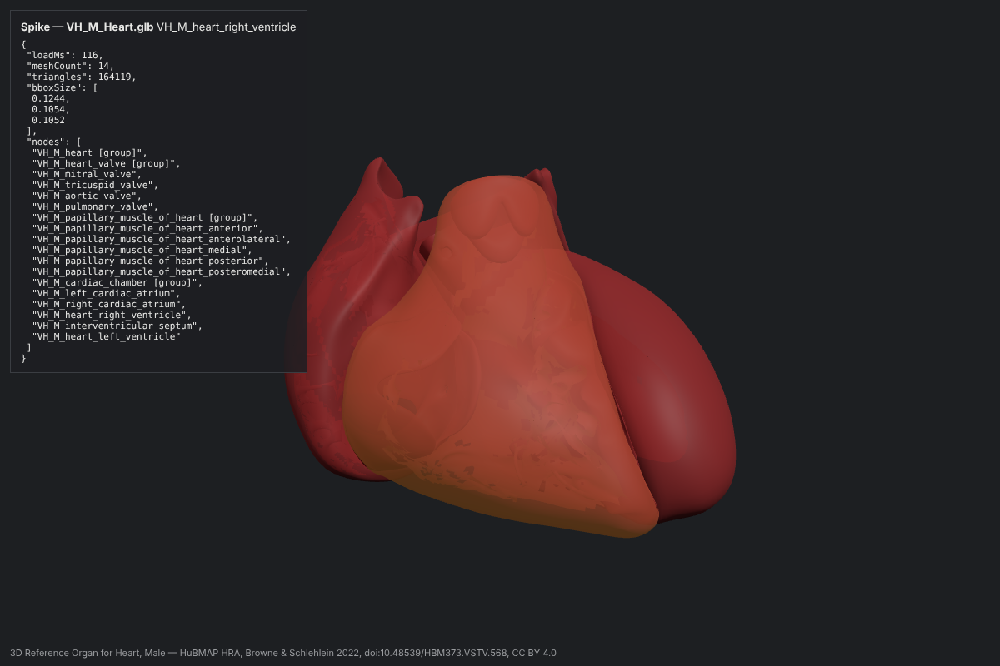

# Data spike — HuBMAP heart in Three.js (2026-11-18)

**Result: the data path works.** The HRA heart GLB downloads (via GitHub mirror), loads in Three.js r170 with the stock GLTFLoader in ~0.1 s (local), renders, and click-picking returns per-structure node names.

Run: `./scripts/download-hubmap-heart.sh && cd spikes/hubmap-heart && npm i && node run.mjs`
(serves `index.html` + model, opens headless Chromium, prints the report, writes `screenshot.png`.)

| Item | Value |
|---|---|
| File | `VH_M_Heart.glb` (HRA release v1.3 folder; model "Heart, Male v1.2") |
| Size | 4,071,500 bytes (3.9 MiB), uncompressed (no Draco/Meshopt) |
| SHA-256 | `b1237e7e765178e9357fd2ea7ccf19d55d0bf9ca55e187886635febe28244c70` |
| Generator | babylon.js glTF exporter for Autodesk Maya 2022.2 |
| Meshes / nodes / materials | 14 / 18 / 1 |
| Triangles | 164,119 |
| Bounding box | 0.124 × 0.105 × 0.105 (metres → ≈12 cm heart) |
| License | CC BY 4.0 |
| Citation | Kristen Browne; Heidi Schlehlein. 2022. *3D Reference Organ for Heart, Male v1.2.* HuBMAP. https://doi.org/10.48539/HBM373.VSTV.568 |
| Picking test | click at viewport centre → `VH_M_heart_right_ventricle` |

## Structures (node → crosswalk ID)

| Node | Label | ID |
|---|---|---|
| VH_M_heart (group) | heart | UBERON:0000948 |
| VH_M_heart_valve (group) | valve | UBERON:0003978 |
| VH_M_mitral_valve | mitral valve | UBERON:0002135 |
| VH_M_tricuspid_valve | tricuspid valve | UBERON:0002134 |
| VH_M_aortic_valve | aortic valve | UBERON:0002137 |
| VH_M_pulmonary_valve | pulmonary valve | UBERON:0002146 |
| VH_M_papillary_muscle_of_heart (group) | papillary muscle of heart | UBERON:0002494 |
| …_anterior / _anterolateral / _medial / _posterior / _posteromedial | papillary muscle heads | FMA:7264 / 7265 / 7262 / 7261 / 7267 (no Uberon) |
| VH_M_cardiac_chamber (group) | — | — |
| VH_M_left_cardiac_atrium | left cardiac atrium | UBERON:0002079 |
| VH_M_right_cardiac_atrium | right cardiac atrium | UBERON:0002078 |
| VH_M_heart_right_ventricle | heart right ventricle | UBERON:0002080 |
| VH_M_interventricular_septum | interventricular septum | UBERON:0002094 |
| VH_M_heart_left_ventricle | heart left ventricle | UBERON:0002084 |

## Findings that affect Milestone 1
1. **No great vessels or coronary arteries in this file** (aorta, pulmonary trunk, venae cavae, pulmonary veins are needed for the blood path). They are in `VH_M_Blood_Vasculature.glb` (7.4 MB) — reachable, not yet inspected.
2. Uncompressed 3.9 MiB → Meshopt/Draco should bring it well under 1 MiB (to measure in M1).
3. One shared material: we assign per-structure materials (recorded in SOURCES.md).
4. Chambers are solid meshes; blood path will follow a spline through chamber/valve centroids.
5. Lungs: `VH_M_Lung.glb` (6.4 MB) reachable.
6. `cdn.humanatlas.io` blocked from this cloud environment; GitHub mirror is byte-identical by design (SHA pinned in script). No manual download needed.

